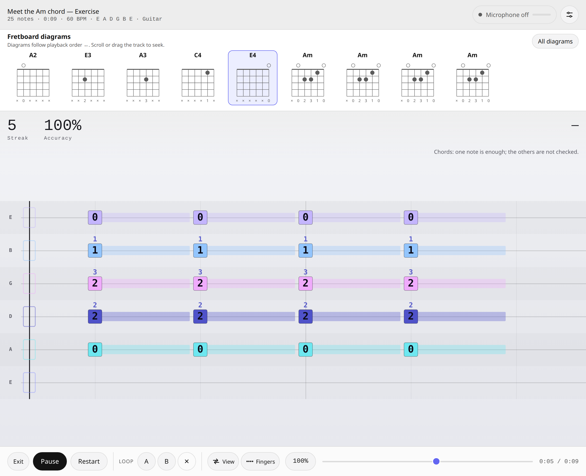
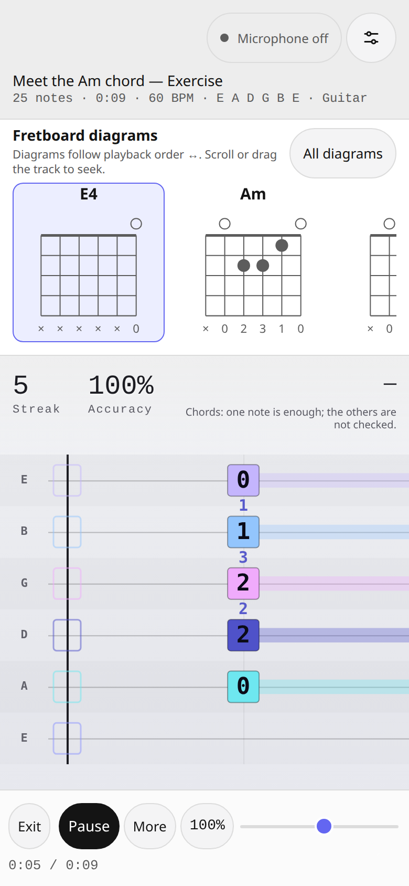
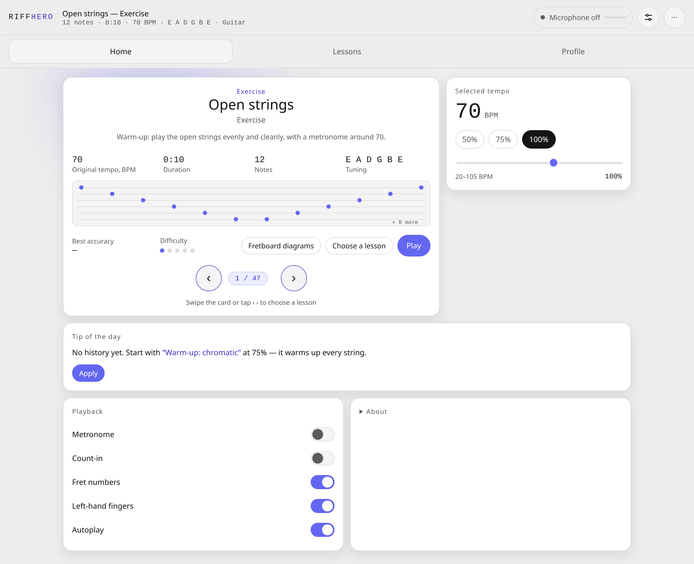
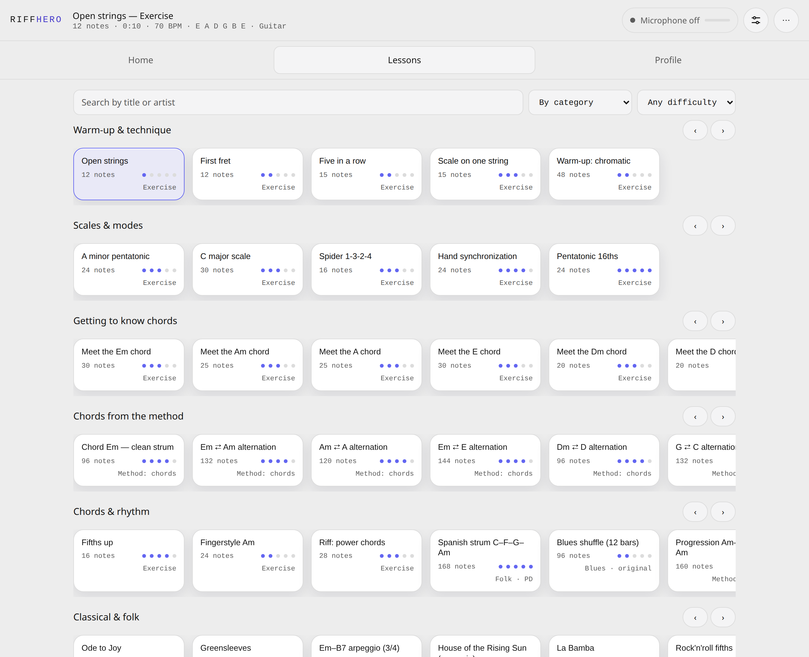
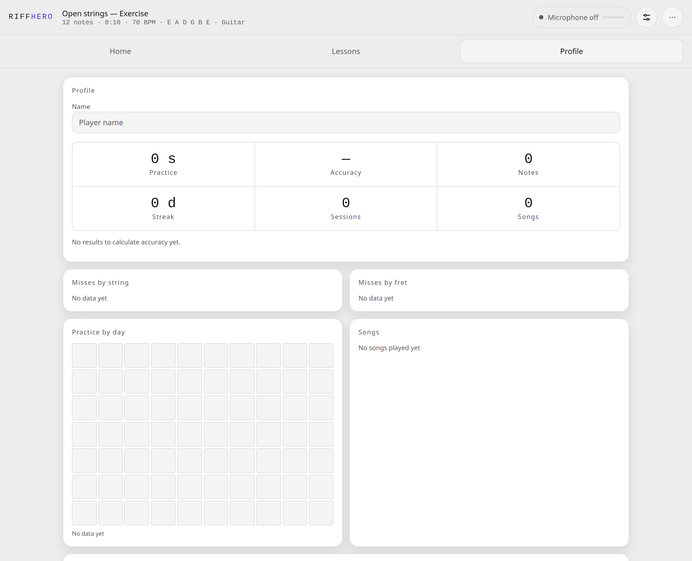
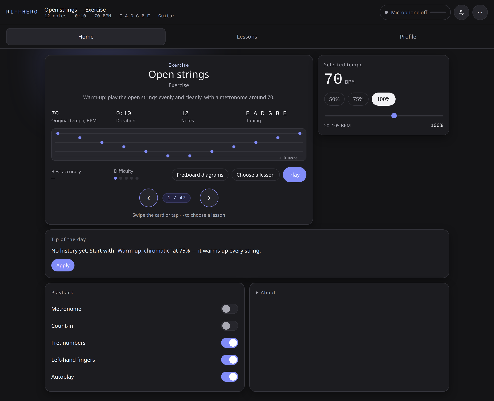
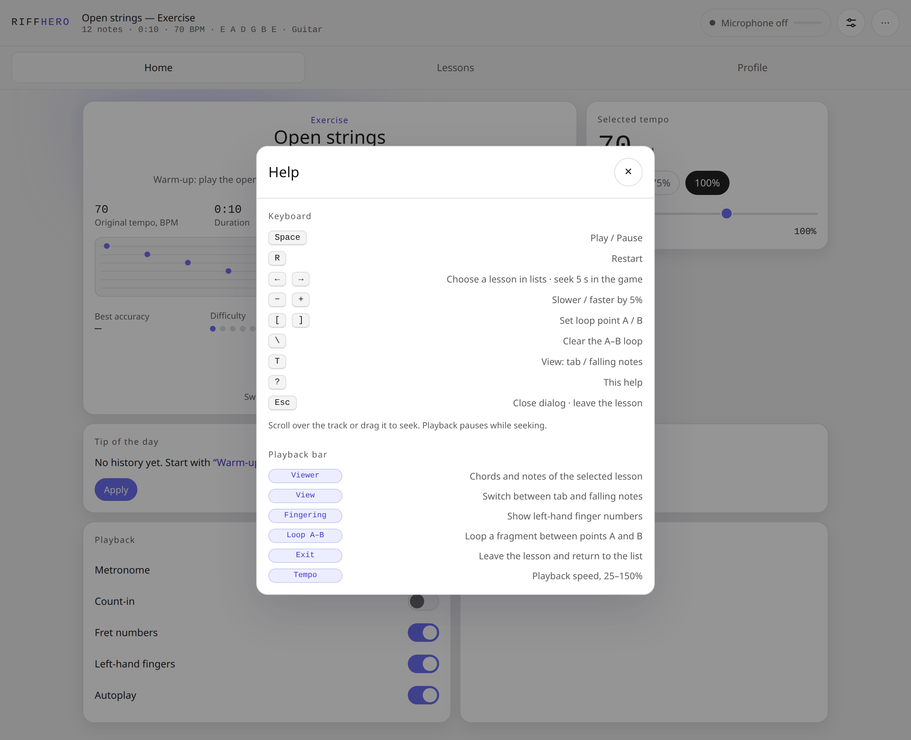

# RiffHero

A browser-based guitar practice app: choose a lesson, play along with tablature, and use a microphone to track your progress. It runs on desktop and mobile without an installation or build step.

**[Open RiffHero](https://difp.github.io/DSV4.1TABS/)** · [Русская версия](README.ru.md)

## Practice

Fretboard diagrams above the track follow playback order. The track shows strings, frets, and note durations; use “All diagrams” to open the full tablature, diagrams, and notes. Scroll over or drag the track to seek and pause playback.



On a phone, additional practice controls are available under “More”.



*Practice screenshots use autoplay for demonstration.*

## Choose a lesson

Choose an exercise, adjust the tempo and start from the home page. The Lessons tab offers search, categories and a difficulty filter. Exercises cover open strings, scales and rhythm, introductions to Em, Am, A, E, Dm, D, G, C and B7, chord changes, and simple pieces.





<details>
<summary>More screenshots: profile, dark theme and help</summary>





</details>

## Getting started

1. Open the app over HTTPS or on `localhost`. Turn on the microphone in the top bar and grant browser permission.
2. Choose an exercise under Lessons, adjust the tempo, and press Play.
3. Play along with the track. To try the app without a guitar, turn on autoplay in the playback settings.

Choose speakers or headphones in the sound settings. In speaker mode, guide notes are muted while the microphone is on to reduce self-recognition; the metronome remains available.

By default, a chord is scored when one note is detected; its other notes are not checked. You can change the assessment mode in sound settings. An in-game hint shows the selected rule.

## Features

- Tempo control, metronome, count-in, A–B loop and alternate track views.
- Import Guitar Pro (`.gp`, `.gpx`), MIDI (`.mid`) and native `.json` files; search and filter the catalog.
- Browser-local profile with practice time, accuracy, mistakes and history; export and import are available.
- English and Russian interface, light and dark themes, installable PWA and offline use after loading.

Imported MIDI notes outside the selected tuning are skipped with a warning. Partial runs and tracks with skipped imported notes are not saved as complete profile results.

Keyboard: `Space` play/pause · `R` restart · `←/→` choose lesson or seek · `−/+` tempo · `[`/`]` set loop A/B · `\` clear loop · `T` switch view · `?` help · `Esc` close/leave.

## Development

Start the local server:

```sh
python3 serve.py
```

Open http://localhost:8000. Add `?demo=1` to enable autoplay. To run the checks, use Node.js:

```sh
node --experimental-default-type=module --test tests/*.test.mjs
```

The entry points are `index.html` and `src/main.js`; the engine lives in `src/engine`, parsers in `src/parsers`, and exercises in `src/songs/demos.js`. The service worker uses network-first caching. The [music theory review](docs/music-theory-review.md) documents the checked corrections and their limits (in Russian).
