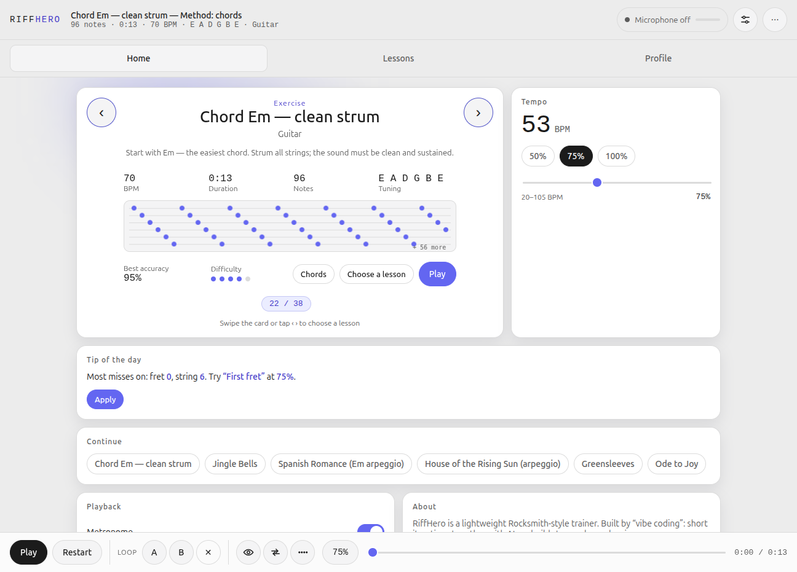
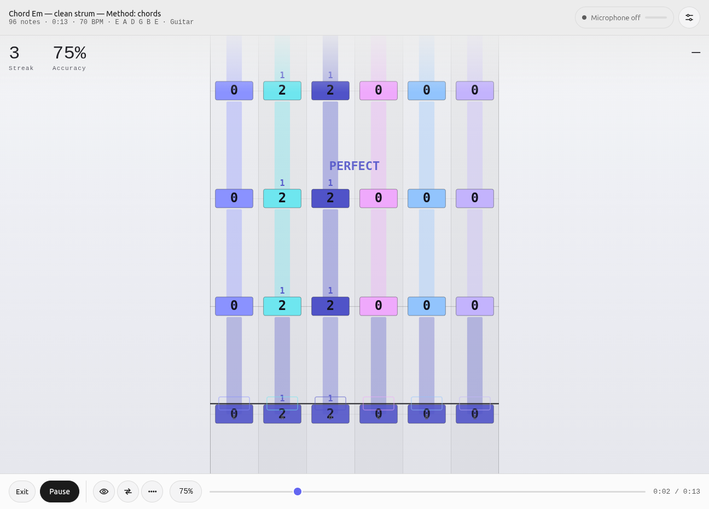
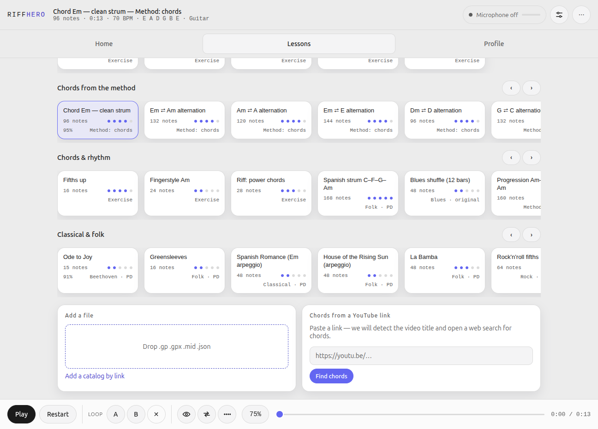
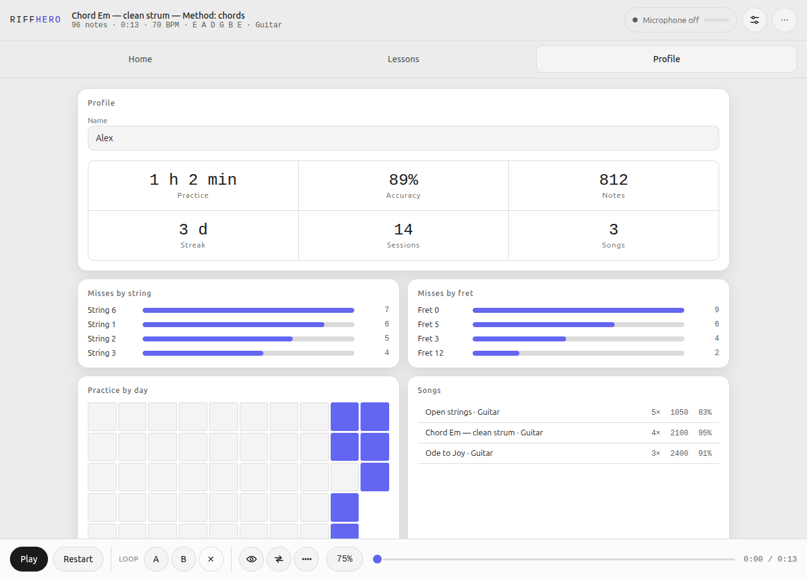
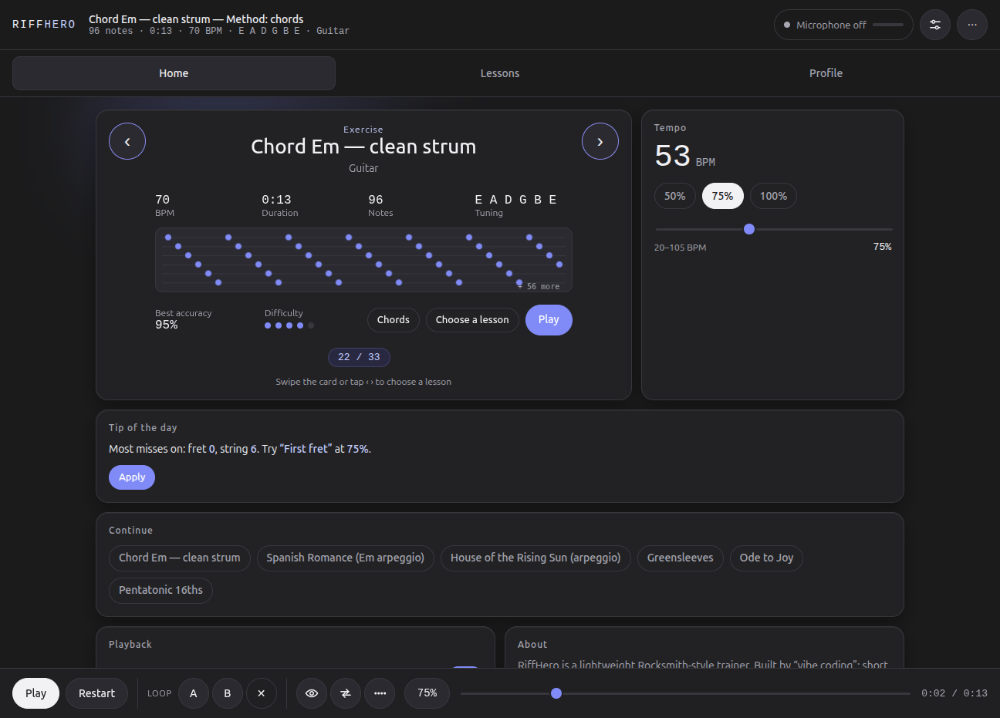
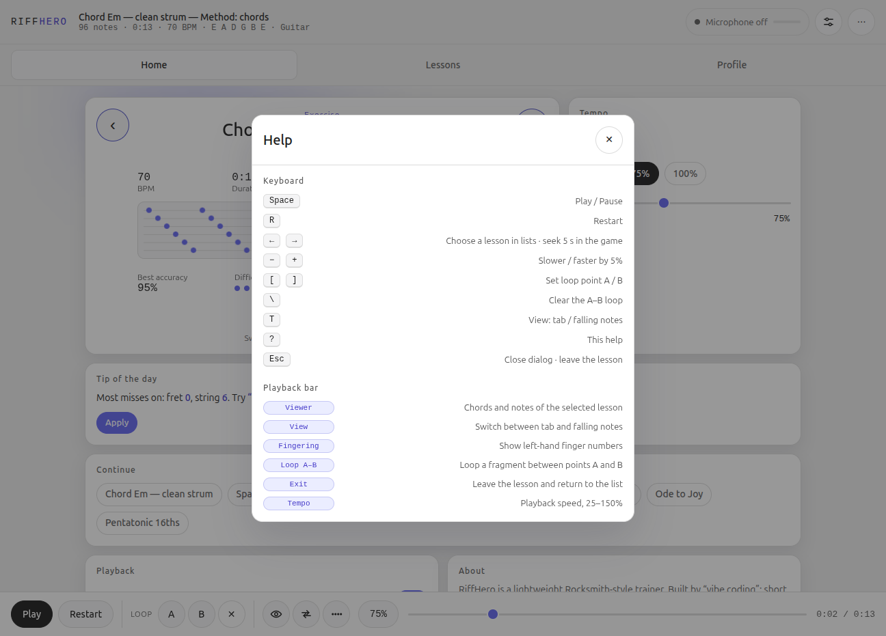

# RiffHero

Браузерный тренажёр гитары в духе Rocksmith: ноты падают по трассе, приложение слушает игру через микрофон (алгоритм YIN) и начисляет очки. Статические файлы, без сборки и зависимостей.

**Играть онлайн:** https://difp.github.io/DSV4.1TABS/ (разрешите доступ к микрофону; для микрофона нужен `localhost` или HTTPS).

## Возможности

- Падающие табы с номерами ладов, сустейном, линиями долей и тактов
- Распознавание нот с микрофона, оценка точности, комбо, итоговая оценка S–E
- Импорт Guitar Pro (`.gp`, `.gpx`), MIDI (`.mid`) и собственного `.json`
- Каталоги песен по файлу или ссылке; поиск, сортировка и фильтр по сложности
- Встроенные занятия (разминка, гаммы, аккорды, классика), набор аккордовых упражнений по самоучителю и простые пьесы (общественное достояние)
- Под названием каждого занятия — краткий методический совет из самоучителя (RU/EN)
- Профиль и статистика (локально): время практики, точность, ошибки по струнам и ладам, календарь занятий, экспорт/импорт
- «Совет на сегодня» по истории ошибок и блок «Продолжить» для недавних занятий
- A/B повтор, скорость 25–150%, метроном, отсчёт, автоигра
- Светлая, тёмная или системная тема; русский и английский интерфейс
- Устанавливается как приложение (PWA) и работает офлайн

| Падающие ноты | Занятия | Профиль |
|---|---|---|
|  |  |  |

| Тёмная тема | Справка |
|---|---|
|  |  |

## Как начать

1. Откройте страницу и разрешите доступ к микрофону.
2. Выберите занятие на вкладке «Занятия» (или нажмите «Играть»).
3. Играйте — приложение слушает и оценивает каждую ноту.

Горячие клавиши: `Space` играть/пауза · `R` сначала · `←/→` выбор занятия или перемотка · `−/+` темп · `[`/`]` точки A/B · `\` сбросить петлю · `T` вид · `?` справка · `Esc` закрыть/выйти.

## Разработка

- Локально: `python3 serve.py` → http://localhost:8000 (сервер без кеша).
- `?demo=1` в адресе включает автоигру — удобно для демонстрации без гитары.
- Точка входа — `index.html` + `src/main.js`; движок в `src/engine`, парсеры в `src/parsers`, встроенные упражнения в `src/songs/demos.js`, строки интерфейса в `src/i18n.js`.
- Офлайн-режим обеспечивает `sw.js` (network-first, кэш как запасной).

## Контент

Классика и фольклор — общественное достояние; рок- и блюз-паттерны — оригинальные. Аккордовые упражнения составлены по последовательности и порядку публичного самоучителя (разминка и хроматика → аккорды Em, Am, A, E, Dm, D, G, C, B7 → чередования → последовательности → арпеджио).
