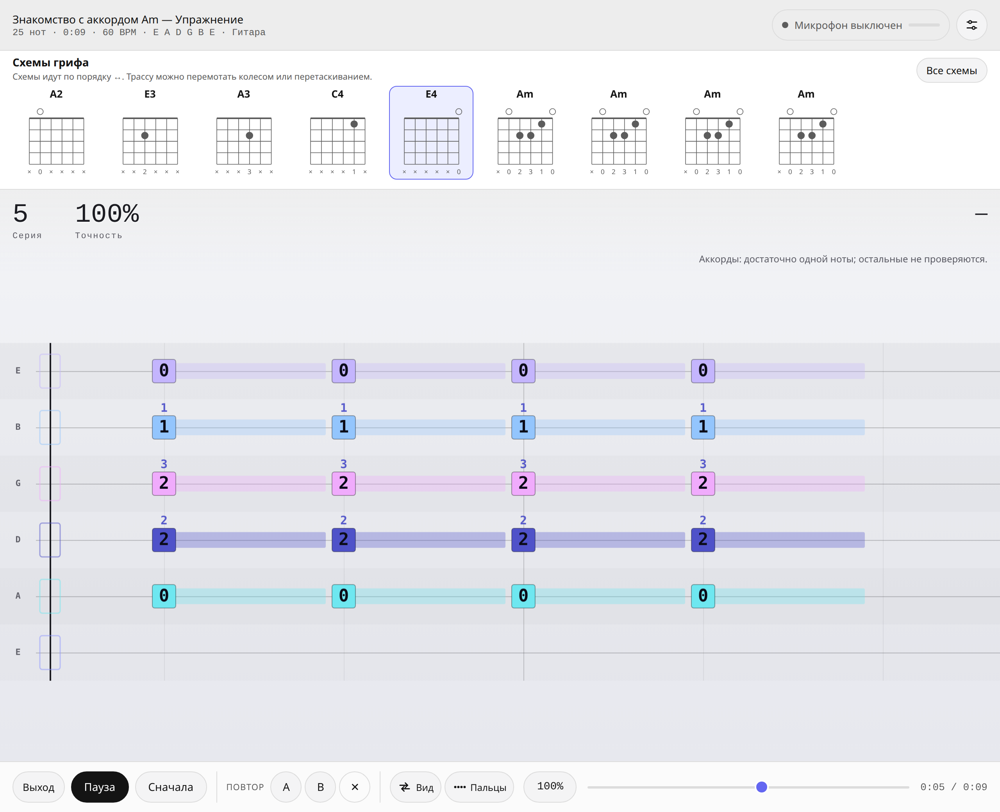
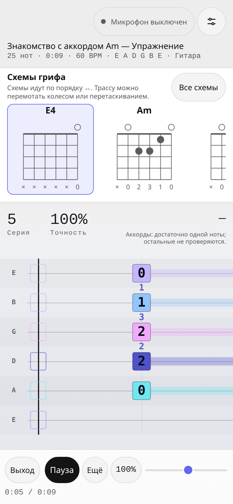
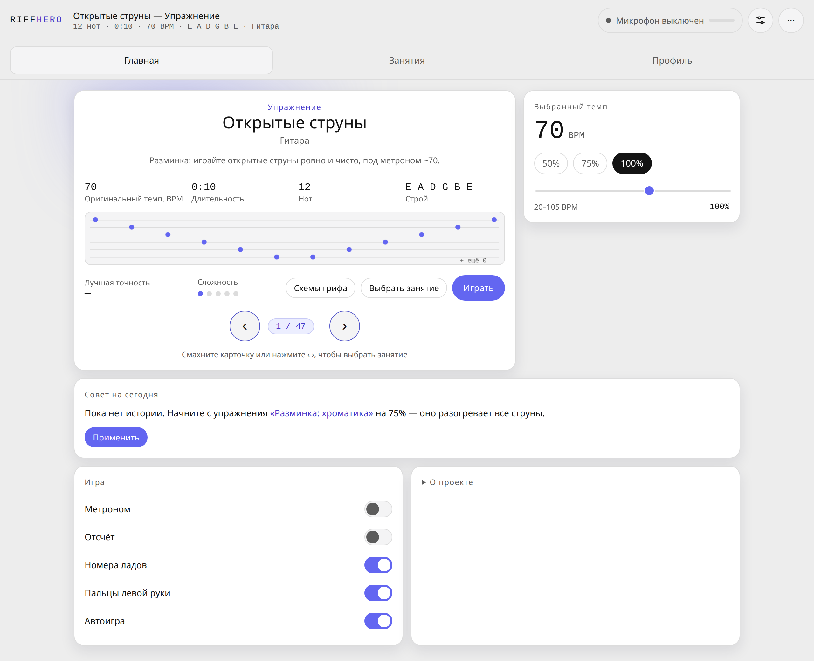
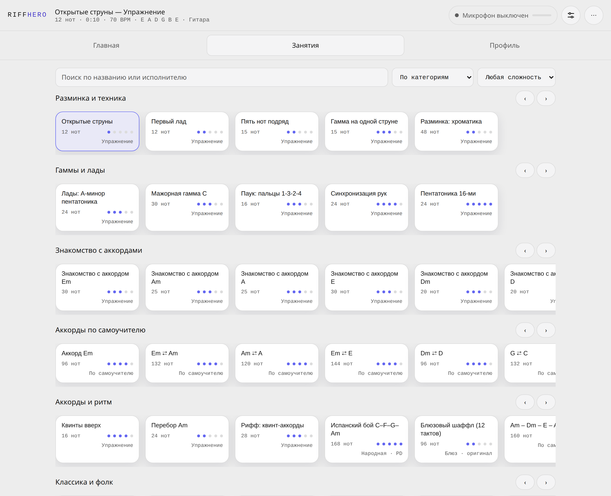
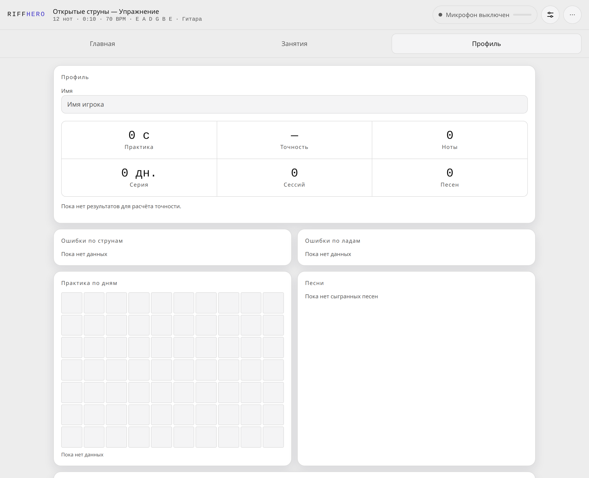
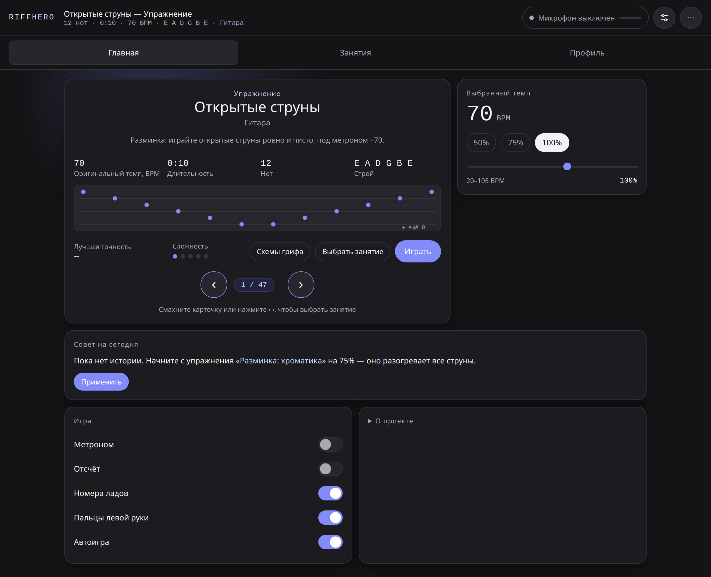
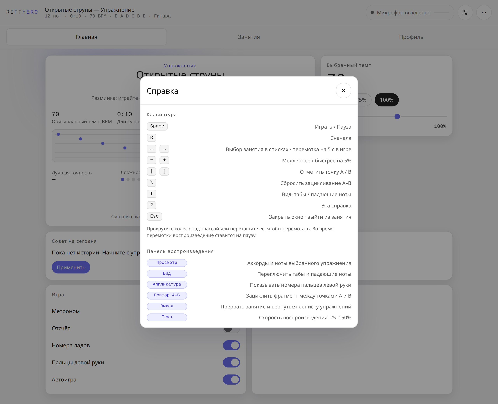

# RiffHero

Браузерный тренажёр для гитары: выбирайте упражнение, играйте по табулатуре и отслеживайте результат с помощью микрофона. Приложение работает на компьютере и телефоне, без установки и сборки.

**[Открыть RiffHero](https://difp.github.io/DSV4.1TABS/)** · [English](README.md)

## Во время занятия

Схемы над трассой показывают положения на грифе в порядке воспроизведения. На трассе указаны струны, лады и длительности; полную табулатуру, схемы и ноты можно открыть кнопкой «Все схемы». Для перемотки прокрутите трассу колесом или перетащите её — воспроизведение поставится на паузу.



На телефоне дополнительные настройки занятия открываются кнопкой «Ещё».



*На скриншотах занятия включена автоигра для демонстрации.*

## Выбор занятия

На главной странице можно выбрать упражнение, настроить темп и запустить тренировку. Во вкладке «Занятия» доступны поиск, категории и фильтр сложности. Есть упражнения на открытые струны, гаммы и ритм, отдельные знакомства с аккордами Em, Am, A, E, Dm, D, G, C и B7, а также пьесы и упражнения на смену аккордов.





<details>
<summary>Ещё изображения: профиль, тёмная тема и справка</summary>





</details>

## Как начать

1. Откройте приложение по HTTPS или на `localhost` и включите микрофон в верхней панели, разрешив доступ браузеру.
2. В разделе «Занятия» выберите упражнение, настройте темп и нажмите «Играть».
3. Играйте по трассе. Для демонстрации без гитары включите автоигру в настройках игры.

В настройках звука выберите динамики или наушники. В режиме динамиков звук нот отключается при включённом микрофоне, чтобы приложение не распознавало собственное воспроизведение; метроном остаётся доступен.

По умолчанию аккорд засчитывается по одной распознанной ноте, остальные его ноты не проверяются. Режим оценки можно изменить в настройках звука. Подсказка во время занятия показывает выбранное правило.

## Возможности

- Регулировка темпа, метроном, отсчёт, повтор участка A–B и переключение вида трассы.
- Импорт Guitar Pro (`.gp`, `.gpx`), MIDI (`.mid`) и собственного формата `.json`; поиск и фильтры в каталоге.
- Профиль хранится в браузере: время практики, точность, ошибки, история занятий; доступны экспорт и импорт.
- Русский и английский интерфейс, светлая и тёмная темы, установка как PWA и работа офлайн после загрузки.

При импорте MIDI ноты за пределами выбранного строя пропускаются с предупреждением. Неполные прохождения и дорожки с пропущенными при импорте нотами не записываются в профиль как завершённые результаты.

Горячие клавиши: `Space` — играть/пауза · `R` — сначала · `←/→` — выбор занятия или перемотка · `−/+` — темп · `[`/`]` — точки A/B · `\` — сброс повтора · `T` — вид · `?` — справка · `Esc` — закрыть/выйти.

## Разработка

Запуск локального сервера:

```sh
python3 serve.py
```

Откройте http://localhost:8000. Параметр `?demo=1` включает автоигру. Для запуска проверок нужен Node.js:

```sh
node --experimental-default-type=module --test tests/*.test.mjs
```

Точка входа — `index.html` и `src/main.js`; движок находится в `src/engine`, парсеры — в `src/parsers`, упражнения — в `src/songs/demos.js`. Service worker использует сеть с резервным кэшем. [Разбор музыкальной теории](docs/music-theory-review.md) описывает проверенные исправления и её ограничения.
